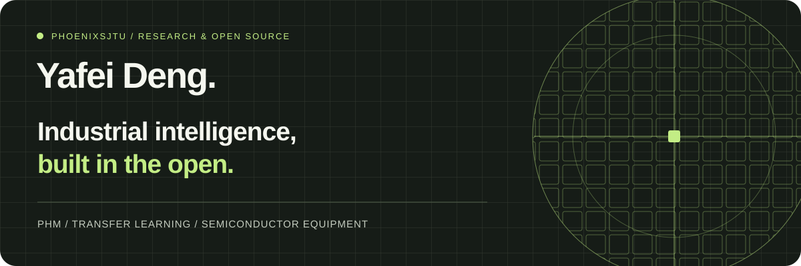

  <a href="https://phoenixsjtu.github.io"><b>个人主页 ↗</b></a> &nbsp; · &nbsp;
  <a href="https://scholar.google.com/citations?user=-mW9Ny0AAAAJ&hl=zh-CN">Google Scholar</a> &nbsp; · &nbsp;
  <a href="https://github.com/phoenixdyf">历史开源项目</a>

### Hi, I'm Yafei Deng.

研究设备如何感知自身状态，以及算法如何帮助设备更可靠地运行。我的工作连接 **设备预测性维护、迁移学习与半导体设备智能化**。

**`phoenixsjtu` 是我目前使用的 GitHub 账号。** 早期研究代码与开源资料保留在 [@phoenixdyf](https://github.com/phoenixdyf)，下方精选项目直接链接到原仓库。

 

## 01 / Research & Engineering

| 研究方向 | 关注的问题 |
| :--- | :--- |
| **半导体设备智能化** | 面向半导体设备开展智能化研究 |
| **Prognostics & Health Management** | 设备预测性维护、故障诊断与剩余寿命预测 |
| **Transfer Learning** | 跨工况、跨设备迁移，以及开放集故障诊断 |
| **Open Research** | 分享研究代码、整理公开数据集与振动分析资料 |

## 02 / Selected Open Source

<table>
<tr>
<td width="50%" valign="top">
<h3>01 · PHM Dataset Collection</h3>

面向故障诊断、健康评估与寿命预测的开源数据集整理，覆盖多种工业设备与应用场景。

<code>PHM</code> <code>Datasets</code> <code>Research Resources</code>

<a href="https://github.com/phoenixdyf/Opensource_Dataset_Compilation_for_PHM"><b>浏览数据集 →</b></a>
</td>
<td width="50%" valign="top">
<h3>02 · Theory-guided Transfer Learning</h3>

结合理论边界与深度对抗网络，探索机械故障开放集诊断迁移。包含 TPTLN 研究演示代码。

<code>Open-set Diagnosis</code> <code>Transfer Learning</code>

<a href="https://github.com/phoenixdyf/Theory-guided-Progressive-Transfer-Learning-Network"><b>查看研究代码 →</b></a>
</td>
</tr>
<tr>
<td width="50%" valign="top">
<h3>03 · Transfer Learning on CWRU</h3>

基于 CWRU 数据集的迁移学习实验，整理特征、参数与对抗迁移方法的 Notebook。

<code>Bearings</code> <code>Domain Adaptation</code> <code>Notebooks</code>

<a href="https://github.com/phoenixdyf/Transfer-Learning-for-CWRU-dataset"><b>探索实验 →</b></a>
</td>
<td width="50%" valign="top">
<h3>04 · Mechanical Vibration Features</h3>

机械振动分析特征参考，整理特征含义、计算方法及其在设备状态分析中的应用。

<code>Signal Processing</code> <code>Feature Engineering</code>

<a href="https://github.com/phoenixdyf/Feature-Introduction-for-Mechanical-Vibration-Analysis"><b>阅读特征指南 →</b></a>
</td>
</tr>
</table>

## 03 / Experience

| 时间 | 经历 | 研究内容 |
| :--- | :--- | :--- |
| **2026 — 至今** | **中微** | 面向半导体设备开展智能化研究 |
| **2024 — 2026** | **华为中央技术研究院** | 设备预测性维护算法研究 |
| **2024.03** | **上海交通大学 · 博士毕业** | Ph.D., Shanghai Jiao Tong University |

## 04 / Research Links

[Google Scholar](https://scholar.google.com/citations?user=-mW9Ny0AAAAJ&hl=zh-CN) · [ResearchGate](https://www.researchgate.net/profile/Yafei-Deng) · [Scopus](https://www.scopus.com/authid/detail.uri?authorId=57201215111)

欢迎围绕设备智能化、PHM、迁移学习与开源研究交流。

 

Yafei Deng · Current account: <a href="https://github.com/phoenixsjtu">@phoenixsjtu</a> · Earlier work: <a href="https://github.com/phoenixdyf">@phoenixdyf</a>
